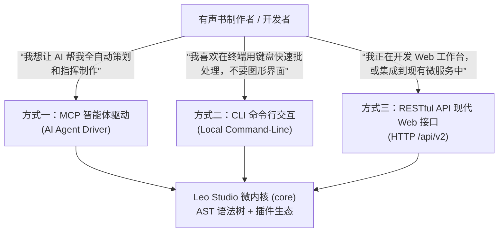

# 🚀 Leo Studio 三大使用方式全景概览 (Three Ways to Use)

Leo Studio 微内核插件架构的一大核心优势在于：**同一套底座业务逻辑，可以通过三种完全不同的人机交互/系统接入形态运行**。

无论你是希望由 **AI 智能体自主指挥**、在 **终端命令行写脚本批量生产**、还是作为 **现代 Web 后端为前端应用提供接口**，Leo Studio 都能原生胜任。

---

## 快速对比与选型指南



| 维度 | 方式一：MCP 智能体驱动 (Agent) | 方式二：CLI 命令行生产 (CLI) | 方式三：RESTful API 现代接口 (API) |
| :--- | :--- | :--- | :--- |
| **接入入口** | `http://127.0.0.1:58685/mcp` | 终端命令 `leo-cli` | `http://127.0.0.1:58685/api/v2/*` |
| **适用角色** | AI 智能体 (Claude, Cursor, Antigravity) | 极客、终端用户、DevOps 自动化脚本 | Web 前端工程师、系统集成商、第三方应用 |
| **是否需要起服务** | 需要（启动 `leo-app`） | **完全不需要**（直接读写本地持久化目录） | 需要（启动 `leo-app`） |
| **交互范式** | 自然语言对话 + 智能体自主调用工具 | 结构化子命令（`import`, `synthesize`...） | 标准 HTTP GET/POST、JSON Payload |
| **自动化程度** | 极高（AI 自动决策声线、审核台词、纠错） | 高（适合 Shell 管道和自动化定时任务） | 依前端交互和业务编排而定 |
| **详细指南** | [👉 查看 MCP 智能体指南](./mcp-agent-guide.md) | [👉 查看 CLI 操作手册](./cli-operations-guide.md) | [👉 查看 API 开发者指南](./api-integration-guide.md) |

---

## 方式一：MCP 智能体驱动 (AI Agent)

> **核心价值：让大语言模型成为你的专属有声剧导演与后期制作人。**

- **协议标准**：遵循 Anthropic 提出的 **Model Context Protocol (MCP)** 标准，基于 Streamable HTTP 协议承载。
- **工作方式**：AI 客户端（如 Claude Desktop, Cursor, Antigravity, OpenManus 等）连接到服务端的 `/mcp` 端点后，会自动获得项目提供的 **20+ 个内置制作工具**。
- **典型场景**：
  > “帮我把刚下载的《开局合欢宗》小说导入 Leo Studio，分析第一章共有多少句对话，挑选一个合适的轻快男声为男主角配音，并把这一章合成为音频。”

👉 **[点击查阅：MCP 智能体驱动实操指南](./mcp-agent-guide.md)**

---

## 方式二：CLI 命令行工具 (`leo-cli`)

> **核心价值：轻巧敏捷、无依赖、极速生产，极客与自动化批处理的最佳伴侣。**

- **独立运行**：直接调用微内核与插件，**无需启动任何后台常驻端口或 Web 服务器**。
- **纯粹高效**：单行命令即可搞定千章小说的全自动解析、清洗、分章、切分台词与导出配音台账。
- **典型场景**：
  ```bash
  # 导入一部小说并自动清洗分章
  cargo run -p leo-plugin-cli -- import 小说.txt

  # 导出配音制作台账 CSV
  cargo run -p leo-plugin-cli -- export <PROJECT_ID> --format csv

  # 一键批量合成指定章节所有片段
  cargo run -p leo-plugin-cli -- synthesize <PROJECT_ID> --chapter 0 --voice zh-CN-YunxiNeural
  ```

👉 **[点击查阅：CLI 命令行极速生产手册](./cli-operations-guide.md)**

---

## 方式三：RESTful API 现代 Web 接口

> **核心价值：面向现代浏览器 Web 工作台与多端跨平台应用的标准数据通道。**

- **架构标准**：基于 Rust 高性能异步网络框架 Axum 构建，统一挂载在 `/api/v2/*` 命名空间。
- **功能完备**：涵盖多格式文件上传导入网关（Multipart）、结构化剧本与 CSV 台账流式导出、章节逐句详情获取、批量语音合成驱动、以及 MP3 音频切片安全拉取。
- **典型场景**：
  - 为 Vue / React / Svelte 打造现代化可视化的有声书创作工作台。
  - 供公司内部内容管理系统（CMS）通过 HTTP 请求实现跨语言远程调度。

👉 **[点击查阅：RESTful API 开发者集成指南](./api-integration-guide.md)**
