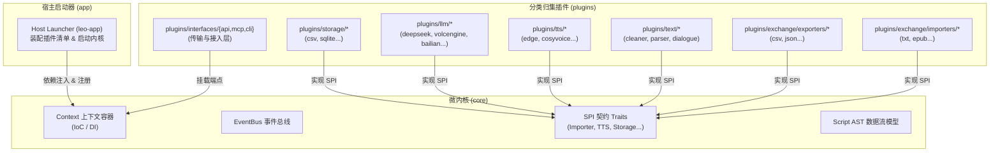
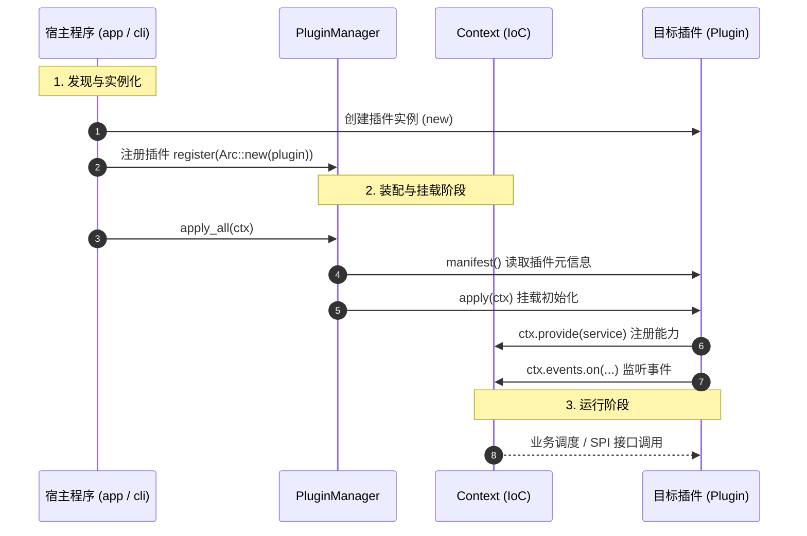

# 🔌 Leo Studio 插件系统架构与开发者指南

欢迎来到 **Leo Studio 插件开发者中心**！

Leo Studio 采用了类似 **Cordis** 的微内核架构设计：**`core` 抽象规约 + `plugins` 分类能力扩展 + `app` 极简总装宿主**。微内核自身不包含任何具体的文件解析规则、特定的音视频编码、具体的存储介质或云端语音合成供应商；所有业务能力全部以**插件（Plugin）**形式解耦实现并分类归集。

---

## 目录导航

为了让开发者能够快速上手、维护与扩展 Leo Studio 插件，我们在本目录组织了系统化的规范与开发指南：

| 文档 | 描述 | 适用对象 |
| :--- | :--- | :--- |
| 📘 [**插件协议与契约规范**](./protocol-specification.md) | 插件 Manifest 元数据规范、生命周期、Context 依赖注入机制与事件流标准 | 所有插件开发者 |
| 🧩 [**核心 SPI 扩展点详解**](./spi-contracts.md) | `Importer`, `Exporter`, `TTSProvider`, `StorageProvider`, `TextCleaner`, `LlmProvider` 等 SPI 接口定义与模型 | 核心功能扩展者 |
| 🔀 [**LLM 协议层**](./llm-protocols.md) | OpenAI Chat / Responses / Anthropic 三套协议的编解码、鉴权与跨协议转换 | LLM 供应商与接入层开发者 |
| 🛠️ [**插件实战开发教程**](./development-guide.md) | 手把手保姆级教程：从 0 到 1 编写一个自定义 TTS 插件与自定义导入器 | 新插件开发实操 |

---

## 插件体系设计哲学

### 1. 严格单向依赖 (Dependency Rule)
- **`core` 绝不依赖任何具体插件**：微内核仅定义纯数据模型（AST）、上下文服务契约（Traits）和事件调度逻辑。
- **插件仅依赖 `core`**：各功能插件相互解耦，禁止插件之间产生循环依赖或强耦合。LLM 子插件额外依赖纯库 `leo-llm-protocol`，它不实现 `Plugin`、不进 `CATALOG`。
- **宿主 `app` 是唯一的总装配中心**：负责按需挑选引入插件，执行依赖注入。

### 2. Cordis 风格的 Context 依赖注入
插件不需要知道是谁在调用它。当插件挂载时，微内核会调用它的 `apply(&self, ctx: &Context)` 方法：
- **提供能力（Provide）**：插件通过 `ctx.provide(service).await` 向系统注入具体服务（例如某个 TTSProvider）。
- **消费能力（Inject）**：插件通过 `ctx.inject::<Arc<dyn TTSProvider>>().await` 获取所需外部能力，若未注入则优雅降级或返回明确错误。

### 3. 分类归集规范 (Directory Taxonomy)
所有插件均归类在 `plugins/` 目录的子类别文件夹中，严禁平铺堆放：
- `plugins/exchange/importers/`：文档导入器（如 txt, docx, epub 等）
- `plugins/exchange/exporters/`：剧本与台账导出器（如 csv, json, fcp-xml 等）
- `plugins/text/`：文本流水线处理插件（清洗 cleaner、分章 parser、切台词 dialogue 等）
- `plugins/tts/`：语音合成引擎（如 edge, cosyvoice, gpt-sovits 等）
- `plugins/llm/`：大语言模型注册层、供应商插件与共享协议库（deepseek / volcengine / bailian）
- `plugins/storage/`：持久化存储插件（如 csv, sqlite 等）
- `plugins/interfaces/api/`：RESTful API 传输层插件（基于 Axum 的 HTTP 服务）
- `plugins/interfaces/mcp/`：Model Context Protocol 传输层插件（让 AI Agent 调度微内核）
- `plugins/interfaces/cli/`：CLI 命令行生产交互插件（提供 `leo-cli` 本地工具）

---

## 插件生命周期

每一个 Leo Studio 插件的生命周期包含以下三个阶段：

1. **注册阶段 (`register`)**：宿主读取配置或依赖，将 `Arc<dyn Plugin>` 注册到 `PluginManager`。
2. **挂载阶段 (`apply`)**：内核调用 `apply(ctx)`，插件在此阶段执行：
   - 向 `Context` 注册具体 SPI 实现（如 `Importer`, `TTSProvider`）。
   - 向 `EventBus` 订阅关心的系统事件。
   - 初始化本地资源（如检查缓存目录、校验本地二进制依赖等）。
3. **运行阶段 (`runtime`)**：传输层（API / MCP / CLI）根据业务请求，通过 `Context` 获取已注册的插件服务执行实际业务。

---

## 快速导航
- 想要了解插件元数据与接口规范？请阅读 [👉 插件协议与契约规范](./protocol-specification.md)。
- 想要实现某个具体的接口（如 TTS、存储、解析）？请阅读 [👉 核心 SPI 扩展点详解](./spi-contracts.md)。
- 想立即动手写一个新插件？请阅读 [👉 插件实战开发教程](./development-guide.md)。
