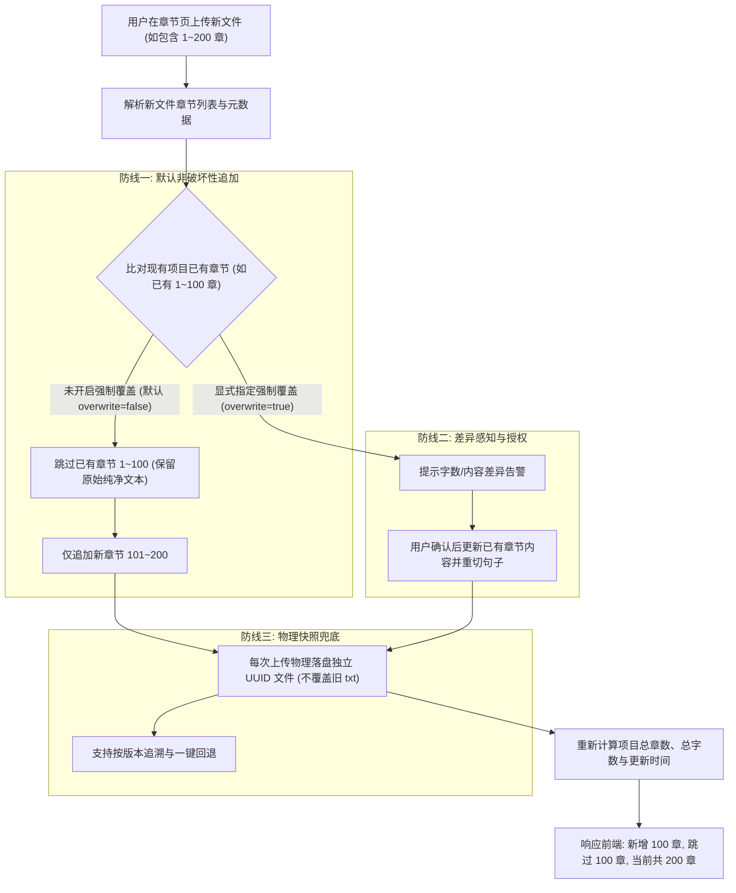

# 小说连载章节增量更新与防污染技术方案

## 1. 业务背景与问题定义

在有声书与小说音频制作平台（Leo Studio）中，小说项目并非一次性终结的静态数据。在实际业务场景中，存在大量**连载中小说**或**多批次交付**的场景：

1. **场景一（纯增量更新）**：
   - 首次创建项目并上传小说：第 1～100 章。
   - 后续随着作者更新，用户上传新批次文件：第 101～200 章。
2. **场景二（全量覆盖更新）**：
   - 首次上传：第 1～100 章。
   - 后续用户重新从网络爬取或导出包含前置章节的完整文稿：第 1～200 章。
3. **核心风险痛点（脏数据污染）**：
   - 用户第二次上传的 `1～200` 章节文稿很可能是从第三方网站爬取的，由于网络防爬、乱码转码、弹窗广告插页、章节截断或 OCR 识别错误，导致新文件里的 `1～100` 章质量极其低劣；
   - 而用户在首次上传的 `1～100` 章是经过人工精校或清洗的高质量正文。
   - **如果系统采用无条件的“静默覆盖（Silent Overwrite）”，就会导致原本干净的高质量章节被劣质爬虫数据瞬间冲垮洗白，造成不可逆的文本数据污染灾难。**

---

## 2. 方案目标

1. **零污染保证（Anti-Pollution）**：默认采用非破坏性更新策略，严禁任何未经授权的旧数据静默冲正。
2. **平滑增量导入（Seamless Append）**：自动智能识别章节断点（无论用户上传的是纯增量 `101～200` 还是全量 `1～200`），无缝追加新章节，保持章节序号连续。
3. **清晰架构边界（Clean Architecture）**：外部接口面向业务由 `projects` 模块统一暴露，底层物理落盘与文本切分复用 `text-files` 核心能力。
4. **可控存储成本（Storage Bounded）**：原始快照与增量存储具备天花板约束，防止物理磁盘被版本历史撑爆。
5. **灾备后悔药（Rollback Capability）**：原始上传物理介质独立留痕，为误操作提供安全回滚空间。

---

## 3. 架构设计：三道安全防线（防盗门模型）

针对脏数据覆盖风险，系统建立三道递进的安全防线：



### 3.1 第一道防线：默认「非破坏性追加」（Append-Only）
- **核心原则**：只接新尾巴，绝不碰旧脑筋。
- **机制**：
  - 无论用户上传的文件内容多大、包含多少前置章节，系统默认只提取“项目中尚未收录的新章节”。
  - 即使新文件中的前 100 章充满错别字或广告乱码，只要识别到该章节在本项目中已存在，系统自动跳过（Skip），原始第 1～100 章保持只读不动。

### 3.2 第二道防线：差异感知与决策权移交（Conflict & Consent）
- **核心原则**：系统不做自作聪明的“黑盒操作”，把破坏性决策权还给用户。
- **机制**：
  - 若作者确实修改了前 100 章剧情，用户确需覆盖更新：
  - 接口提供显式参数 `overwrite_existing: bool = False`。
  - 只有在调用方明确传入 `overwrite_existing=True` 时，系统才对变动章节的正文、字数以及切句进行刷新替换。

### 3.3 第三道防线：物理快照留痕与后悔药（Version Snapshot）
- **核心原则**：磁盘物理文件与版本解耦，永远留有回退路径。
- **机制**：
  - 每次用户上传的文件都生成唯一的 UUID（如 `storage/uploads/text-files/{file_id}.txt`）独立落盘，绝不物理覆盖原有的 txt 文件。
  - 数据库记录小说与文件的关联生命周期，一旦发生误操作，随时可恢复指定版本。

---

## 4. 存储成本与膨胀控制机制

针对多版本快照是否会导致磁盘占满的顾虑，经架构测算与工业实践论证如下：

### 4.1 文本与音频的体量算账
* **纯文本（微型量级）**：
  - 100 章小说（约 30 万字）UTF-8 纯文本仅约 **800 KB**。
  - 哪怕是 300 万字全本巨作，纯文本也仅约 **6～8 MB**。
  - 保留 3～5 个版本快照，总占用通常小于 **30 MB**。
* **音频资产（巨型量级）**：
  - 100 章合成后的高音质音频（WAV/MP3）体积高达 **1 GB ～ 2 GB**。
* **结论**：文本历史快照所占空间不足音频资产的 **1%**，在存储成本上极具性价比。

### 4.2 存储防爆的三大紧箍咒
1. **滑动窗口淘汰机制（Sliding Window Retention）**：
   - 单个项目物理文件快照默认最多保留最近 3 版。
   - 当上传第 4 版时，系统自动清理最旧的第 1 版原始物理文稿，确保物理存储空间严格封顶。
2. **章节记录增量写入（Incremental Rows）**：
   - 数据库层面（`novel_contents.csv` / `novel_sentences.csv`）只为新增的 101～200 章追加记录行，已有章节行不复制、不翻倍，数据行数纯线性增长。
3. **定稿与归档清理（Archive Cleanup）**：
   - 项目母带就绪、全本导出或超过保护周期后，支持一键清除非必要的中间上传草稿，仅保留最终正文。

---

## 5. 模块职责与 API 边界划分

```text
┌────────────────────────────────────────────────────────┐
│ 前端项目章节视图 (Project Chapter View: desktop/...)    │
└───────────────────────────┬────────────────────────────┘
                            │ 携带 project_id + 上传文件
                            ▼
┌────────────────────────────────────────────────────────┐
│ projects 业务模块 (POST /api/v1/projects/{id}/chapters) │
│                                                        │
│  1. 权限校验与项目存在性检查                             │
│  2. 调用底层存储保存物理快照与清洗分章                    │
│  3. 章节序号与标题归一化比对（防污染过滤）                │
│  4. 追加新章节、重算字数/章数、更新项目状态              │
└───────────────────────────┬────────────────────────────┘
                            │ 依赖注入内部调用
                            ▼
┌────────────────────────────────────────────────────────┐
│ text_files 基础设施模块 (TextFileStorageService)        │
│                                                        │
│  - 安全文件名清洗、类型白名单校验                        │
│  - 物理文件流式安全写入 (UUID 命名)                     │
│  - 纯文本编码自动侦测与 clean_text 清洗                 │
│  - 正则分章 (parse_chapters) 与智能切句                 │
└────────────────────────────────────────────────────────┘
```

- **为何不让前端直连 `text-files`？**
  - `text-files` 是底层无状态的文件基础设施，无项目感知能力。
  - 若前端直连需执行“先上传文件 -> 获得 file_id -> 再请求项目绑定章节”的两步操作，极易因网络波动导致数据孤立（产生未绑定项目的垃圾文件）和并发冲突。
  - 由 `projects` 统一收拢入口，对外一步原子完成，对内复用成熟存储能力。

---

## 6. 核心接口规范

### 6.1 接口定义

- **路径**：`POST /api/v1/projects/{project_id}/chapters/upload`
- **请求格式**：`multipart/form-data`
- **标签**：`项目管理`

### 6.2 请求参数

| 参数名 | 传输位置 | 类型 | 必填 | 默认值 | 说明 |
| :--- | :--- | :--- | :--- | :--- | :--- |
| `project_id` | Path | `string (UUID)` | 是 | - | 目标项目唯一标识 |
| `file` | Form (File) | `UploadFile` | 是 | - | 增量小说文稿（.txt / .md 等） |
| `overwrite_existing` | Form (Field) | `boolean` | 否 | `false` | 是否覆盖已有同序号/同名章节（默认 `false` 仅追加新章节，防止污染） |
| `dry_run` | Form (Field) | `boolean` | 否 | `false` | 是否仅做差异预检（为 `true` 时返回差异分析，不实际写入数据） |

### 6.3 响应参数

响应结构统一包装于标准 `ApiResponse` 中：

```json
{
  "code": 200,
  "data": {
    "project_id": "9b1deb4d-3b7d-4bad-9bdd-2b0d7b3dcb6d",
    "file_id": "a3bb189e-3294-4d8b-9447-0e6d628867a1",
    "version_id": "8f7e6d5c4b3a210987654321fedcba98",
    "version_number": 2,
    "added_chapters": 100,
    "skipped_chapters": 100,
    "total_chapters": 200,
    "total_words": 602340,
    "has_conflicts": false,
    "conflicts": [],
    "updated_at": "2026-10-27T19:30:00+08:00"
  },
  "message": "章节追加成功，新增 100 章，跳过 100 章"
}
```

### 6.4 配套版本快照与回滚接口

| 接口说明 | 方法 | 路径 | 核心能力 |
| :--- | :--- | :--- | :--- |
| 查询历史快照列表 | `GET` | `/api/v1/projects/{project_id}/versions` | 查看版本号、章节数、字数及操作备注（受滑动窗口最多 3 版约束） |
| 一键版本回退 | `POST` | `/api/v1/projects/{project_id}/versions/{version_id}/rollback` | 恢复至指定版本快照，重新构建章节与切句（终极防污染后悔药） |

---

## 7. 章节智能匹配与归一化算法

为精准匹配“第一章”、“第1章”、“Chapter 1”等跨源爬虫格式差异，匹配算法采用**正则归一化键（Normalized Chapter Key）**：

1. **中文数字与阿拉伯数字归一转换**：
   - 对标题前缀匹配 `第\s*([0-9零一二三四五六七八九十百千万]+)\s*[章回节卷篇集]` 或 `Chapter\s*(\d+)`。
   - 利用数字转换算法将“一百零一”与“101”统归一化为整型数字 `101`，生成指纹键 `ch_101`。
2. **非编号章节保底**：
   - 对于“前言”、“引言”、“尾声”、“大结局”等无明确编号的章节，以去除空白后的纯文本作为比对指纹。
3. **序号自动顺延**：
   - 新增章节的 `chapter_index` 严格按照当前项目内已存最大序号 `max_index + 1` 顺延生成，确保阅读树逻辑序列绝对连续。

---

## 8. 实施状态（已全面落地）

1. **Schema & Model**：已定义 `ProjectChapterAppendInfo`、`ChapterConflictInfo`、`ProjectVersionInfo`、`ProjectRollbackInfo` 领域模型与对应响应 Schema。
2. **差异比对与预检（Dry-run）**：已在 `append_chapters` 中支持比对内容差异并提供 `dry_run` 预检模式。
3. **版本快照与滑动窗口淘汰**：已实现 `project_versions.csv` 持久化，严格限制每个项目最多保留 3 个历史快照，自动清理物理旧快照。
4. **一键版本回滚**：已实现 `rollback_project_version`，支持任意有效历史版本一键回退重构。
5. **API 路由与文档**：
   - `POST /api/v1/projects/{project_id}/chapters/upload`（增量/全量追加上传）
   - `GET /api/v1/projects/{project_id}/versions`（版本快照列表）
   - `POST /api/v1/projects/{project_id}/versions/{version_id}/rollback`（一键版本回退）
6. **自动化测试**：27 个项目管理用例全面覆盖增量追加、防污染保留、差异预检、滑动窗口淘汰（超 3 版自动清理）与一键回滚。

