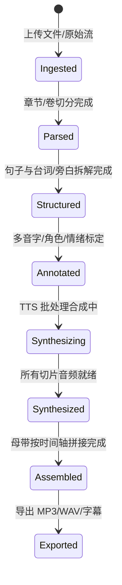

# Leo Studio 插件化架构设计方案（基于 Cordis 思想）

> **分支**：`feature/plugin-framework`  
> **设计哲学**：借鉴 **Cordis**（微内核、可逆生命周期、服务容器）与 **dsh / pi**（极简调度核心驱动万物）的思想，将 Leo Studio 从固定单体演进为**高可扩展、高容错、可插拔的有声书制作引擎**。

---

## 1. 架构愿景与哲学

### 1.1 现状与痛点
当前 Leo Studio 后端（Rust/Axum）虽然分层清晰（Text / Storage / Modules / MCP），但各组件之间存在深度的**硬编码耦合**：
- **文本清洗**绑定了特定的 800 行颜文字正则；
- **分章切句**绑定了特定的中文数字正则与成对双引号规则；
- **存储**硬编码为 6 张固定表头的 CSV 文件；
- **缺少核心音频链路**：如果要接入 CosyVoice、Edge-TTS、ChatTTS 等多样化的语音模型，或者接入 LLM 角色分析，按当前单体模式会迅速导致后端膨胀失控。

### 1.2 Cordis 哲学映射
在 **dsh / pi** 中：
- **微内核核心**：仅有 **`Agent Loop`**（输入 → 推理 → 工具调用 → 状态递进）。
- **外部生态**：模型适配器、工具集、Memory 机制全都是通过 Cordis 挂载的插件。

在 **Leo Studio** 中：
- **微内核核心**：**`Script AST`（剧本语法树）** + **`Pipeline Loop`（生产管线状态调度器）**。
- **外部生态**：导入器、清洗器、分章器、台词提取器、多音字库、TTS 语音引擎、存储介质、导出器、MCP/REST 传输层**全部作为插件实现**。

```
┌────────────────────────────────────────────────────────────────────────┐
│                        Leo Kernel (微内核核心)                         │
│                                                                        │
│   ┌──────────────────────────┐      ┌──────────────────────────────┐   │
│   │    Universal Script AST  │      │     Pipeline Event Loop      │   │
│   │   (通用的剧本抽象语法树) │ ───► │  (状态机调度与脏标记失效追踪)│   │
│   └──────────────────────────┘      └──────────────────────────────┘   │
│                                                     │                  │
│               Context 树 (服务注册、生命周期与事件总线)                  │
└─────────────────────────────────────┬──────────────────────────────────┘
                                      │
         ┌────────────────────────────┼───────────────────────────┐
         ▼                            ▼                           ▼
┌──────────────────┐        ┌──────────────────┐        ┌──────────────────┐
│  Parser Plugins  │        │   TTS Plugins    │        │ Storage Plugins  │
│ - 正则分章       │        │ - CosyVoice      │        │ - CSV (兼容旧版) │
│ - AI 语义分章    │        │ - Edge-TTS       │        │ - SQLite         │
│ - 双引号台词切分 │        │ - ChatTTS        │        │ - PostgreSQL     │
│ - 颜文字清洗     │        │ - Azure Speech   │        │                  │
└──────────────────┘        └──────────────────┘        └──────────────────┘
```

---

## 2. 微内核两大底层核心定义

内核只沉淀两个绝对通用、不依赖任何具体业务算法的基石：

### 2.1 核心一：通用剧本抽象语法树（Universal Script AST）
所有的插件（不论是导入器、清洗器还是 TTS 引擎），都不直接操作原始纯文本，而是围绕一份规范化的 AST 进行读写与标注（Annotations）。

```
Project (剧目根节点)
 ├── metadata: { id, title, author, targetAudience, ... }
 └── volumes: [Volume] (卷/分部)
      └── chapters: [Chapter] (章节)
           ├── metadata: { id, index, title, rawWordCount, status }
           └── paragraphs: [Paragraph] (自然段)
                └── sentences: [Sentence] (单句)
                     └── segments: [Segment] (片段)
                          ├── kind: Narration (旁白) | Dialogue (台词) | SFX (音效)
                          ├── text: String
                          ├── speaker: Option<SpeakerBinding> (角色绑定)
                          ├── annotations: Vec<Annotation>
                          │    ├── PolyphoneAnnotation (多音字注音: pinyin, tone, charIndex)
                          │    ├── EmotionAnnotation (情绪基调: happy, angry, whispered...)
                          │    ├── PauseAnnotation (句中停顿毫秒数)
                          │    └── SpeedRateAnnotation (局部语速倍率)
                          └── audio: Option<AudioClipRef> (关联生成的音频切片引用)
```

### 2.2 核心二：生产管线循环与状态机（Pipeline Loop）
有声书生产是严格的有向流水线，微内核维护状态流转图：



#### 局部失效与脏标记追踪（Dirty Tracking & Invalidation DAG）
有声书制作非常昂贵（大模型推理与 TTS 合成费时耗算力）。内核必须提供**最小颗粒度失效追踪**：
- 用户在工作台修改了第 5 句的一个字：
  - 核心**只将该句及对应 Segment 的状态标记为 `Dirty`**；
  - 仅使该句已生成的 `AudioClipRef` 失效；
  - 其余已生成的音频切片**绝对不重复合成**；
  - 下次触发合成时，流水线仅过滤出 `Dirty` 的节点跑 TTS 插件。

---

## 3. 插件协议规范（Plugin Protocol Specification）

Leo Studio 插件规范参考 Cordis 的 Service 与 Hook 契约设计。

### 3.1 插件元数据（Manifest）
每个插件必须具备自描述清单：
```json
{
  "id": "leo-plugin-tts-cosyvoice",
  "name": "CosyVoice 语音合成插件",
  "version": "1.0.0",
  "author": "Leo Studio Community",
  "category": "tts",
  "dependencies": {},
  "capabilities": ["tts:stream", "tts:clone_voice"],
  "configSchema": {
    "type": "object",
    "properties": {
      "endpoint": { "type": "string", "default": "http://127.0.0.1:9233" },
      "concurrency": { "type": "integer", "default": 2 }
    }
  }
}
```

### 3.2 插件分类契约（SPI 扩展点）

#### 1. 文本处理插件（`TextProcessingPlugin`）
```rust
#[async_trait]
pub trait TextCleanerPlugin: Send + Sync {
    /// 对原始输入行或段落进行清洗
    fn clean(&self, text: &str) -> String;
}

#[async_trait]
pub trait SplitterPlugin: Send + Sync {
    /// 识别章节边界
    fn parse_chapters(&self, text: &str) -> Vec<RawChapter>;
    /// 识别单句内台词与旁白
    fn extract_dialogues(&self, sentence: &str) -> Vec<RawSegment>;
}
```

#### 2. 语音合成插件（`TTSPlugin`）
```rust
#[derive(Debug, Clone)]
pub struct SynthesisRequest {
    pub text: String,
    pub speaker_voice_id: String,
    pub speed: f32,
    pub pitch: f32,
    pub emotion: Option<String>,
    pub annotations: Vec<Annotation>,
}

#[derive(Debug, Clone)]
pub struct SynthesisResult {
    pub audio_bytes: Vec<u8>,
    pub sample_rate: u32,
    pub duration_ms: u64,
    pub format: AudioFormat, // WAV / MP3 / OPUS
}

#[async_trait]
pub trait TTSPlugin: Send + Sync {
    /// 返回该插件支持的声音音色清单
    async fn list_voices(&self) -> Vec<VoiceDescriptor>;
    /// 合成单条台词/旁白切片
    async fn synthesize(&self, req: SynthesisRequest) -> Result<SynthesisResult, PluginError>;
}
```

#### 3. 存储引擎插件（`StoragePlugin`）
```rust
#[async_trait]
pub trait StoragePlugin: Send + Sync {
    async fn load_project(&self, id: &str) -> Result<Option<Project>, StorageError>;
    async fn save_project(&self, project: &Project) -> Result<(), StorageError>;
    async fn save_audio_clip(&self, clip_id: &str, data: &[u8]) -> Result<PathBuf, StorageError>;
    async fn query_audio_clip(&self, clip_id: &str) -> Result<Option<Vec<u8>>, StorageError>;
}
```

#### 4. 传输通道插件（`TransportPlugin`）
- `AxumHttpTransport`：对外暴露标准 REST 接口；
- `McpTransport`：对外暴露 Model Context Protocol 接口；
- `CliTransport`：提供命令行脚本执行批处理。

---

## 4. 插件管理方案（Plugin Manager Architecture）

```
                         ┌───────────────────────┐
                         │     PluginManager     │
                         └──────────┬────────────┘
                                    │
       ┌────────────────────────────┼────────────────────────────┐
       ▼                            ▼                            ▼
┌──────────────┐             ┌──────────────┐             ┌──────────────┐
│  Registry    │             │  Container   │             │  LifeCycle   │
│ - 发现 & 注册 │             │ - 依赖注入   │             │ - 加载 / 挂起│
│ - 配置校验   │             │ - Context 树 │             │ - 卸载 / 回滚│
└──────────────┘             └──────────────┘             └──────────────┘
```

### 4.1 插件装配与生命周期（借鉴 Cordis）
每个插件挂载时获得一个独立的 `PluginContext`：
1. **`apply(ctx)`**：插件在此方法内注册能力、提供 Service、监听 Hook。
2. **`on_unload`**：插件被禁用或卸载时，微内核自动将该插件注册的事件监听和扩展路由**安全注销**，不影响系统其它部分。
3. **空间隔离（Scoped Context）**：
   - 全局级：如系统存储插件、系统日志；
   - 剧目级（Project-Scope）：某本古风小说可以专门启用“古风音色插件”和“文言虚词分句插件”，不污染其它剧目。

### 4.2 插件实现载体选型
考虑性能与生态，支持两种形态：
1. **内置原生 Rust 插件（Native / Statically Linked Plugins）**：
   - 核心自带：`csv-storage`、`regex-parser`、`edge-tts`、`kaomoji-cleaner`。
   - 零性能损耗、编译期类型检查。
2. **外部进程 RPC 插件（Out-of-Process / gRPC / Stdio）**：
   - 用于对接 Python 庞大的 AI 音频生态（如官方开源的 CosyVoice、ChatTTS、F5-TTS 往往是 Python 库）；
   - 通过轻量 JSON-RPC / gRPC 与 Rust 内核通信，崩溃隔离，不把 Rust 主进程搞垮。

---

## 5. 项目目录规划树（规划演进）

按微内核架构规划重构后的工程目录结构：

```text
leo-studio/
├── docs/                                  # 架构文档与接口契约
│   └── solutions/
│       ├── novel-chapter-update-solution.md
│       ├── mcp-server-plan.md
│       └── plugin-framework-architecture.md  # 本方案
│
├── core/                                  # 【微内核】独立无业务逻辑
│   ├── Cargo.toml
│   └── src/
│       ├── ast/                           # 剧本通用语法树
│       │   ├── mod.rs
│       │   ├── node.rs                    # Project, Chapter, Sentence, Segment
│       │   └── annotation.rs              # 多音字、情感、停顿标记
│       ├── context/                       # 依赖注入容器与 Context 树
│       │   ├── mod.rs
│       │   └── container.rs
│       ├── pipeline/                      # 生产管线与状态机循环
│       │   ├── mod.rs
│       │   ├── stage.rs                   # PipelineStage 定义
│       │   ├── loop_driver.rs             # 驱动管线执行
│       │   └── dirty_tracker.rs           # 细粒度局部失效追踪
│       ├── plugin/                        # 插件契约与管理器
│       │   ├── mod.rs
│       │   ├── manifest.rs                # 插件清单与元数据
│       │   ├── traits.rs                  # Clean, Split, TTS, Storage SPI
│       │   └── manager.rs                 # 插件注册、拓扑排序与热重载
│       └── error.rs
│
├── plugins/                               # 【官方内置插件集】
│   ├── cleaner-kaomoji/                   # 颜文字与机械清洗插件
│   ├── parser-novel-regex/                # 中文网络小说正则分章/分句插件
│   ├── dialogue-quotes/                   # 中文双引号台词/旁白切分插件
│   ├── storage-csv/                       # 原现存 6 张 CSV 表存储插件（保证向下兼容）
│   ├── storage-sqlite/                    # 现代化 SQLite 本地轻量数据库插件
│   ├── tts-edge/                          # 微软 Edge-TTS 免费语音合成插件
│   ├── tts-cosyvoice-rpc/                 # CosyVoice Python RPC 语音插件
│   └── export-ffmpeg/                     # FFmpeg 音频合并与字幕导出插件
│
├── backend/                               # 【主机应用程序 Host App】
│   ├── Cargo.toml                         # 引用 core 与选用的 plugins
│   └── src/
│       ├── main.rs                        # 组装内核，加载启用的插件
│       ├── app.rs                         # 装配 HTTP 与 MCP
│       ├── transports/                    # 通讯通道
│       │   ├── rest/                      # /api/v1, /api/v2
│       │   └── mcp/                       # Model Context Protocol
│       └── config.rs                      # 服务配置与插件启用开关
└── (前端部分后续独立重新设计，此处暂不规划)
```

---

## 6. 分阶段落地路线图（Milestones）


1. **Phase 1（内核确立）**：
   - 在 `core/ast` 中建立标准的 `Script AST` 结构；
   - 建立 `Pipeline` 状态枚举与脏标记传递逻辑。
2. **Phase 2（模块解耦）**：
   - 把 `backend/src/text/kaomoji.rs` 包装为 `TextCleaner` 插件；
   - 把 `parsers.rs` / `dialogue.rs` 包装为 `Splitter` 插件；
   - 把 `Store` 包装为实现 `StoragePlugin` 的 CSV 适配器。
3. **Phase 3（真正发声，补齐拼图）**：
   - 接入第一个轻量 TTS 插件（如基于 Tokio 的 `Edge-TTS` 客户端，无需部署庞大 Python 模型即可生成高质量多角色人声）；
   - 在句子/片段层打通音频切片生成。
4. **Phase 4（导出与全链路闭环）**：
   - 打通音频合并，导出第一部完整的有声小说章节 MP3 母带与字幕文件；
   - 通过 REST API / MCP 工具验证全链路顺畅。前端后续另行独立全新设计。
