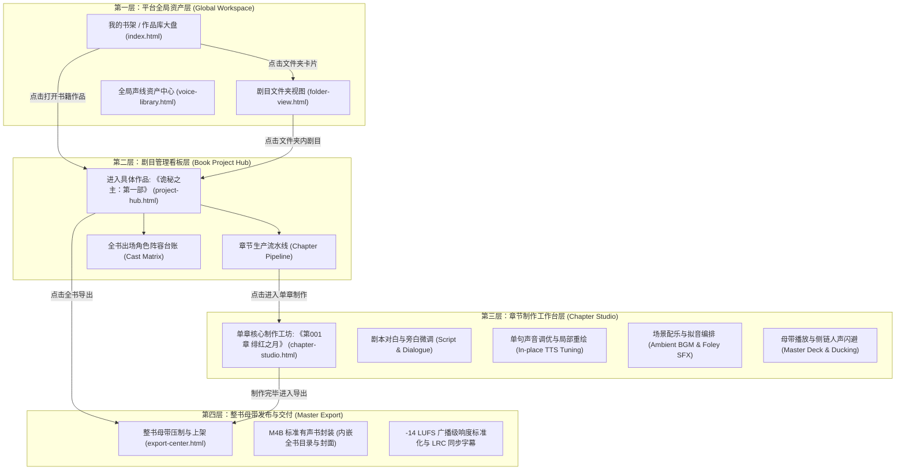

# VoiceNovel AI (开源多角色AI有声书与全景声广播剧制作引擎) 🎙️📖

> **工业级有声书创作系统：打破平铺单页的混乱，建立专业严谨的三层架构 (全局大盘 ➔ 剧目流水线 ➔ 章节制作工作台 ➔ 整书母带导出)**

---

## 🧭 正确的信息架构与页面层级规范 (Strict Information Architecture)

根据 **Descript, ElevenLabs Projects, Premiere Pro** 等顶级生产力产品的严谨设计范式，有声书制作绝不是无上下文的平铺页面，而是具备清晰的 **【全局层】**、**【剧目上下文层】** 与 **【章节制作层】**：



---

## 📁 页面职责与直接访问路径

| 页面模块 | 访问文件 | 所属层级 | 核心业务职责与操作 |
| :--- | :--- | :--- | :--- |
| **1. 我的书架 (作品库)** | [prototype/index.html](file:///Users/leo/Documents/One-project/leo/prototype/index.html) | 全局大盘 | 创作者首页，管理所有作品制作进度，支持导入 TXT/EPUB 建立新剧目。 |
| **2. 剧目看板与角色阵容** | [prototype/project-hub.html](file:///Users/leo/Documents/One-project/leo/prototype/project-hub.html) | 单书上下文 | 《诡秘之主》总控台：包含**章节生产流水线**（按章节推进）与**全书角色阵容台账**（绑定与试听声线）。 |
| **3. 章节核心制作工作台** | [prototype/chapter-studio.html](file:///Users/leo/Documents/One-project/leo/prototype/chapter-studio.html) | 章节制作 | 核心制作工坊：剧本对白分色、多音字划词纠错、单句换种子局部重绘、场景配乐与拟音 (Foley) 编排、底部母带播放器。 |
| **4. 整书母带导出中心** | [prototype/export-center.html](file:///Users/leo/Documents/One-project/leo/prototype/export-center.html) | 单书交付 | 全书 M4B 商业级有声书压制封装（内嵌章节书签与封面）、-14 LUFS 响度标准化、真机听书效果预览。 |
| **5. 全局声线资产库** | [prototype/voice-library.html](file:///Users/leo/Documents/One-project/leo/prototype/voice-library.html) | 全局资产 | 账号级全局音色库：官方预置声线、3秒零样本克隆实验室 (Zero-Shot Clone)。 |
| **6. 剧目文件夹视图** | [prototype/folder-view.html](file:///Users/leo/Documents/One-project/leo-studio/ui-原型图/prototype/folder-view.html) | 全局大盘 | 从书架点击文件夹卡片进入：返回按钮 + 文件夹名 + 文件夹内剧目网格，仅保留搜索，无 tab / 排序 / 新建文件夹入口。 |

---

## 🧩 原型 → desktop 移植流程（强制）

1. 页面一律先在本目录 `prototype/*.html` 里设计与调整；
2. 每个页面**逐页**交由使用者核对确认后，才允许在 `desktop/`（Next.js）里新建或改写对应页面；
3. 严禁跳过核对，直接把原型改动同步进 `desktop/`。

`desktop/` 当前已移植：`prototype/index.html` → `desktop/app/project/page.tsx`（路由 `/project`）、`prototype/folder-view.html` → `desktop/app/folder/[id]/page.tsx`（路由 `/folder/[id]`）。其余页面（project-hub / chapter-studio / export-center / voice-library）尚未移植。

---

## 🚀 极速预览方式

纯静态高保真构建，无打包工具依赖，支持直接双击或通过命令行打开：

```bash
# 直接在默认浏览器中打开书架大盘：
open prototype/index.html
```

或通过本地 HTTP 预览：
```bash
cd /Users/leo/Documents/One-project/leo
python3 -m http.server 8080
# 访问: http://localhost:8080/prototype/
```

---

## 📚 专业产品与架构文档

- [页面层级与信息架构规范说明书 (ui_ux_architecture.md)](file:///Users/leo/Documents/One-project/leo/docs/ui_ux_architecture.md)
- [系统定位与行业调研深度分析 (audiobook_spec.md)](file:///Users/leo/Documents/One-project/leo/docs/audiobook_spec.md)
- [RESTful & WebSocket 核心接口规范 (api_specification.md)](file:///Users/leo/Documents/One-project/leo/docs/api_specification.md)
