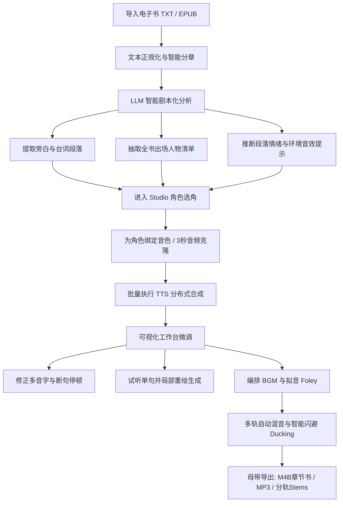

# 开源多角色AI有声书与全景声广播剧制作引擎 (VoiceNovel AI / EchoScript Studio)

## 一、 项目背景与定义

### 1.1 项目核心定位
**VoiceNovel AI** 是一个面向创作者、独立工作室与网文平台的**端到端开源AI有声书与全景声广播剧创作工作流系统（Audiobook & Drama Digital Audio Workstation）**。

它旨在打破传统 TTS 工具仅能“单文本朗读”的局限，提供**“小说文档导入 → LLM 剧本化与角色智能拆解 → 多角色音色矩阵选角与克隆 → 段落级情绪与多音字微调 → BGM/拟音环境音效自动编排 → 母带级多轨混音与 M4B/Stems 导出”**的全链路工程化方案。

---

### 1.2 传统制作痛点 vs. 本项目的创新范式

| 维度 | 传统商业录音棚流程 | 现有通用 TTS 工具 (如 EdgeTTS/普通SaaS) | **VoiceNovel AI (本项目架构)** |
| :--- | :--- | :--- | :--- |
| **制作周期** | 1本80万字小说需专业配音员+后期团队耗时 **1~3个月** | 机器实时推流，但长文本需人工分片，经常中断 | **全自动分章批处理+分布式任务调度**，数小时完成整本预生成 |
| **说话人解析** | 人工剧本标注员逐行打角色标签 | 无法识别说话人，单一声音通篇朗读到底 | **LLM Agent 剧本化**：自动区分旁白与各角色对白，识别上下文说话人 |
| **情绪与演技** | 配音演员现场表演演绎 | 语气平淡呆板，无起伏，甚至笑哭同音 | **上下文情绪语义感知**：注入喜怒哀乐、咆哮、低语、叹气与呼吸音控制 |
| **音效与配乐** | 后期制作师在 Reaper/ProTools 中逐轨挂贴 BGM 与拟音 | 纯干音（Dry Audio），无背景音，无氛围 | **场景感知伴奏与 Foley 音效引擎**：自动匹配环境音，支持多轨混音与智能闪避 (Sidechain Ducking) |
| **成品标准** | 输出带章节标签的 M4B 或 MP3 CUE 格式 | 输出无数零碎 mp3 片段，缺乏元数据和章节索引 | **母带级渲染**：输出 Apple Books / Audible 标准 M4B（内嵌封面、章节标记、分轨 Stems） |

---

### 1.3 核心技术模块架构

整个系统分为五大核心子系统：

```
+-----------------------------------------------------------------------------------+
|                        VoiceNovel Studio WebUI / Desktop                          |
|    (剧本工作台 | 角色选角台账 | 段落音频微调 | 多轨时间轴混音器 | M4B母带导出)    |
+-----------------------------------------------------------------------------------+
                                         │  REST / WebSocket
                                         ▼
+-----------------------------------------------------------------------------------+
|                           VoiceNovel Orchestration API                            |
+-------------------+--------------------+--------------------+---------------------+
| 1. 文本与剧本引擎  | 2. 选角与音色引擎   | 3. 韵律微调引擎    | 4. 混音与音效引擎   |
| - TXT/EPUB 解析器 | - 角色音色库 (Cosy)| - 多音字注音字典   | - 场景氛围 BGM 编排 |
| - 智能章节划分    | - Zero-shot 克隆   | - SSML/情感强度调节| - Foley拟音匹配     |
| - LLM 角色对白归属| - 角色特征档案卡   | - 呼吸/静音插帧    | - 智能闪避 (Ducking)|
+-------------------+--------------------+--------------------+---------------------+
                                         │
                                         ▼
+-----------------------------------------------------------------------------------+
|                           AI Audio Model Infer Engine                             |
|  - TTS: CosyVoice 2 / Fish Speech / F5-TTS / ChatTTS / Edge-TTS fallback          |
|  - LLM: Qwen2.5-72B / DeepSeek-V3 (角色关系提取、上下文情绪与发音判定)             |
|  - Audio Post: FFmpeg, SoX, Librosa, PyDub, Matchering (LUFS 母带标准化)          |
+-----------------------------------------------------------------------------------+
```

---

## 二、 业界现状与使用实践调研

### 2.1 商业级标杆产品分析
1. **ElevenLabs Projects (全球行业标杆)**:
   - **特点**: 支持数万字长文本按段落分配角色 Voice Actor；支持发音替换字典（Pronunciation Dictionary）；支持单段局部重新生成（Regenerate）保持上下文连贯。
   - **局限**: 商业闭源且高昂，对中文语境、网文修仙/武侠专有名词（如“金丹”、“筑基”、“重[chóng]霄”）缺乏深度方言与多音字专门纠偏机制；BGM与音效支持较弱。
2. **NotebookLM Audio Overview (Google)**:
   - **特点**: 将枯燥文档自动转为双人自然对话播客，插话、停顿、互相反驳极其自然。
   - **启示**: 有声书中的多人对话不能机械一问一答，需要自然的断句、微停顿（Inter-speaker Pause: 200~450ms）与微小的情绪递进。
3. **喜马拉雅 (攀登计划 / AI主播) & 番茄小说 AI 听书**:
   - **实践经验**: 头部平台在工业化生产中，核心指标是 **WER (字错误率 < 0.5%)**、**多音字准确率 (>99.2%)** 和 **端到端生成成本 (< 0.1元/千字)**。
   - **痛点**: 平台自研系统不对外开源，独立作家和个人播客创作者无法自由控制版权、定制专属声线或离线部署私有化剧本。

### 2.2 开源生态技术选型建议

| 模块 | 推荐开源项目 | 选型优势 | 备选方案 |
| :--- | :--- | :--- | :--- |
| **TTS 基座** | **CosyVoice 2** / **Fish Speech 1.5** | 自然度极高，零样本极速克隆（3秒参考音频），对中文支持出色，支持情绪控制 | F5-TTS (速度极快), ChatTTS (语气词丰富), Edge-TTS (轻量零成本降级) |
| **剧本理解与角色提取** | **Qwen2.5-14B / 32B / 72B** | 中文上下文推理最强，能准确分析复杂古代/现代网文中无主语对白的说话人 | DeepSeek-V3, Llama-3.1-8B-Instruct |
| **多音字与拼音纠错** | **Pypinyin + 自定义行业词库** | 高精度拼音解析，配合正则与 LLM 歧义消解（例如“行[xíng/háng]业”、“着[zhuó/zhe/zháo]火”） | G2P-China, FastG2P |
| **音频母带处理** | **FFmpeg + Pydub + Matchering** | 自动化侧链压缩闪避（Ducking）、广播级响度均衡（-14 LUFS）、M4B 章节封装 | SoX, Librosa |

---

## 三、 典型业务制作工作流 (End-to-End Pipeline)


