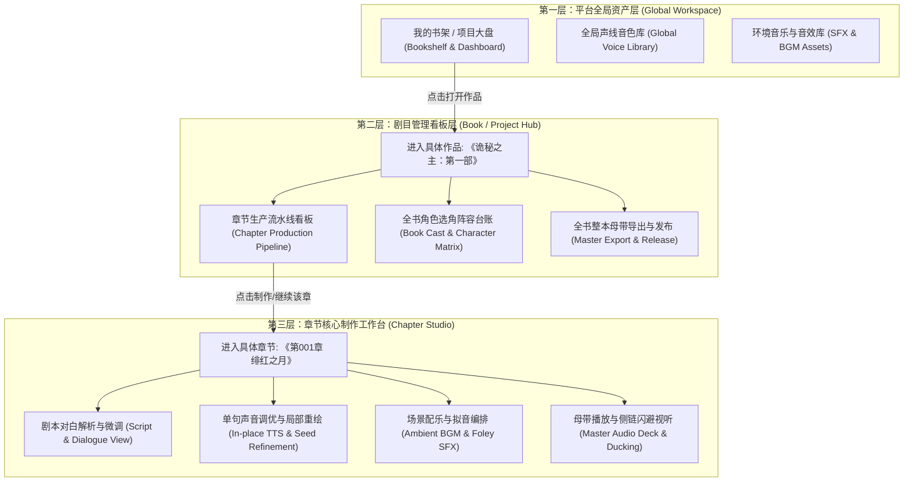

# VoiceNovel AI 页面层级与信息架构规范 (UI/UX Architecture & Product Logic)

---

## 1. 为什么上一版逻辑存在致命缺陷？

在专业数字内容创作软件（如 **Descript, ElevenLabs Projects, Premiere Pro, Figma**）中，页面绝对不能是“平铺并列”的。
上一版设计的根本性错误在于：
> **将“全局层”与“项目私有层”混为一谈，缺少【项目上下文 (Project Context)】与【章节上下文 (Chapter Context)】。**

* **错误表现**：顶栏平铺“项目总览、智能剧本、角色选角、混音时间轴、母带导出”。
* **逻辑崩溃点**：
  1. 用户在没有任何上下文时，如果点击“混音时间轴”，系统根本不知道要混哪本书、哪一章的音？
  2. “角色选角”到底是一本书的选角，还是整个平台的音色库？
  3. 为什么用户改完剧本，要跳去一个完全割裂的独立网页去改音色，再跳到另一个独立网页去看波形？

---

## 2. 真正的专业有声书软件信息架构 (IA)

专业商业级有声书与广播剧制作系统，必须具备严格的**三层上下文结构**：



---

## 3. 核心实体关系模型 (Domain Entity Model)

系统底层的业务对象关系必须严谨对齐：

```
+-------------------------------------------------------------------------------+
| Workspace (工作区 / 创作者空间)                                               |
|  ├── Global Voice Assets (全局预置音色 / 自定义克隆声线)                       |
|  └── Book Projects (书籍作品列表)                                             |
|       │                                                                       |
|       ├── Character Ledger (全书角色台账)                                     |
|       │    ├── Character: [克莱恩·莫雷蒂] ── 绑定 ──> Cloned Voice: [英伦青年] |
|       │    └── Character: [旁白]         ── 绑定 ──> Preset Voice: [沧桑男中] |
|       │                                                                       |
|       └── Chapters (章节列表: 第001章, 第002章...)                             |
|            │                                                                  |
|            ├── Paragraphs (段落序列)                                          |
|            │    ├── Paragraph #1: Type=Narration, Speaker=旁白, Text=...      |
|            │    └── Paragraph #2: Type=Dialogue, Speaker=克莱恩, Emotion=惊恐 |
|            │                                                                  |
|            ├── Audio Assets (生成的音频切片)                                   |
|            │    ├── Speech Clips (TTS干音)                                    |
|            │    ├── Ambient Track (背景氛围乐)                                |
|            │    └── Foley Track (环境拟音，如雷鸣、关门)                      |
|            │                                                                  |
|            └── Chapter Rendered Master (本章渲染后的母带音频)                  |
+-------------------------------------------------------------------------------+
```

---

## 4. 页面清单与职责划分 (The 4 Core Screens)

为了保证商业成熟度、简洁与操作顺畅，前端拆分为 **4 个具备明确上下文关系的独立页面**：

### 页面 1：`index.html` - 平台书架与项目中心 (Bookshelf Dashboard)
* **所属层级**：全局层 (Global Context)
* **业务目标**：创作者登录后的主页面，纵览所有有声书作品进度。
* **核心内容**：
  * 书架卡片流（作品封面、总字数、音频总长、完成百分比、最近编辑章节）。
  * 关键统计指标（已制作总时长、调用声线数、GPU 推理集群状态）。
  * 全局操作：导入小说创建新书向导（支持 TXT/EPUB 解析）。
  * 全局导航：我的书架、全局音色库、设置。

### 页面 2：`project-hub.html` - 剧目看板与角色阵容 (Book Project Hub)
* **所属层级**：单书上下文层 (Book Level Context: 如《诡秘之主》)
* **业务目标**：负责整本书的宏观筹备与生产流推进。
* **核心内容**：
  * **顶栏面包屑**：明确提示当前处于 `平台书架 > 《诡秘之主：第一部》`。
  * **两大核心标签页**：
    1. **章节生产流 (Chapter Pipeline)**：章节列表树，清晰展示每章的生产状态（文本就绪 ➔ 剧本拆解 ➔ 角色配音 ➔ 混音对齐 ➔ 母带就绪），提供“进入制作”按钮。
    2. **全书角色矩阵 (Cast Matrix)**：全书出场人物清单、出场台词比重、绑定的音色卡片、试听与 3秒零样本克隆。
  * **右上角主动作**：一键全书导出 M4B。

### 页面 3：`chapter-studio.html` - 章节核心制作工作台 (Chapter Studio)
* **所属层级**：章节制作层 (Chapter Level Context: 如《诡秘之主》> 第001章 绯红之月)
* **业务目标**：创作者停留时间最长的“核心战场”，实现**剧本与音频一体化制作（Script-Driven DAW）**。
* **核心内容**：
  * **左侧章节与段落导航 (Slim Outline)**：快速切换段落或跨章节。
  * **中央智能剧本流 (Script Canvas)**：
    * 角色卡片分色展示（旁白蓝、男主紫、女主粉）。
    * 多音字划词纠错（如 `重(chóng)叠`）。
    * 情绪风格控制（如 `惊恐迷茫 85%`）。
    * 局部重新推理（单句換随机 Seed 重新合成）。
    * 拟音音效插入锚点（如 `[拟音: 暴雨与风声 1.2s]`）。
  * **底部母带多轨时间轴底座 (Docked Audio Mixer)**：
    * 播放/暂停控制，时间码同步。
    * 语音轨、BGM 轨（带智能闪避 Ducking 凹陷动画）、拟音轨实时对齐。
    * 真实 Web Audio API 程序化发声体验。

### 页面 4：`export-center.html` - 整书母带导出与交付中心 (Master Export Center)
* **所属层级**：单书交付层 (Book Level Release)
* **业务目标**：母带级压制封装与多渠道上架导出。
* **核心内容**：
  * **交付格式矩阵**：
    * **M4B 广播级有声书**（Audible / Apple Books 标准，内嵌无缝章节目录、封面与元数据）。
    * **MP3 播客标准包**（320kbps + ID3v2 章节标记）。
    * **分轨工程包 (Stems ZIP)**（干音/BGM/拟音分轨导出）。
  * **声学标准化控制**：-14.0 LUFS 广播级响度标准化、AAC 192k 编码、LRC 同步字幕。
  * **右侧手机端播放器高保真预览**：直观展示书籍在用户手机端上的章节结构与封面效果。
